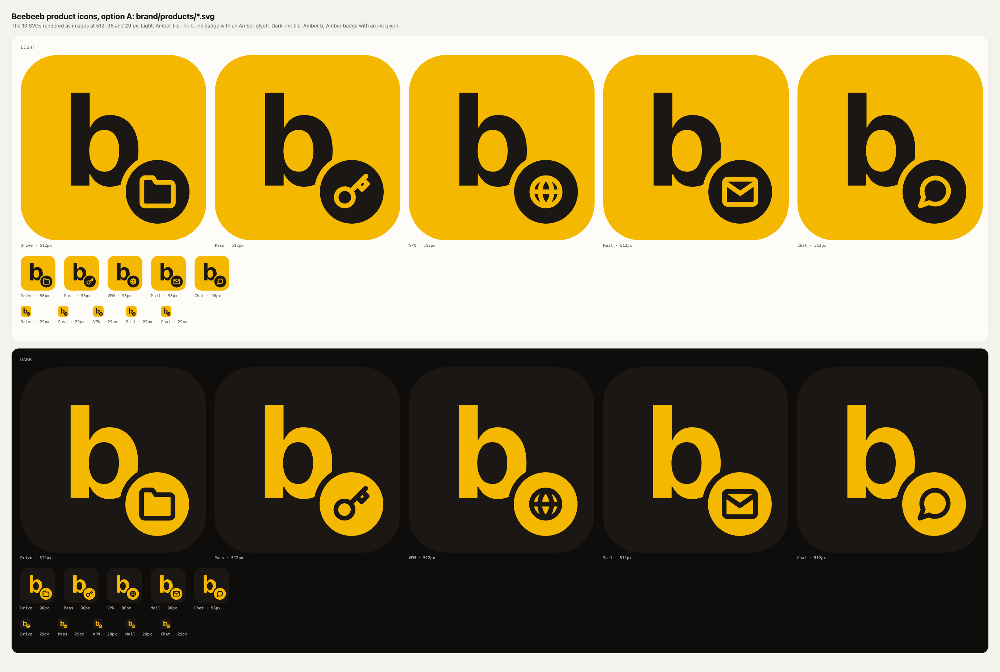
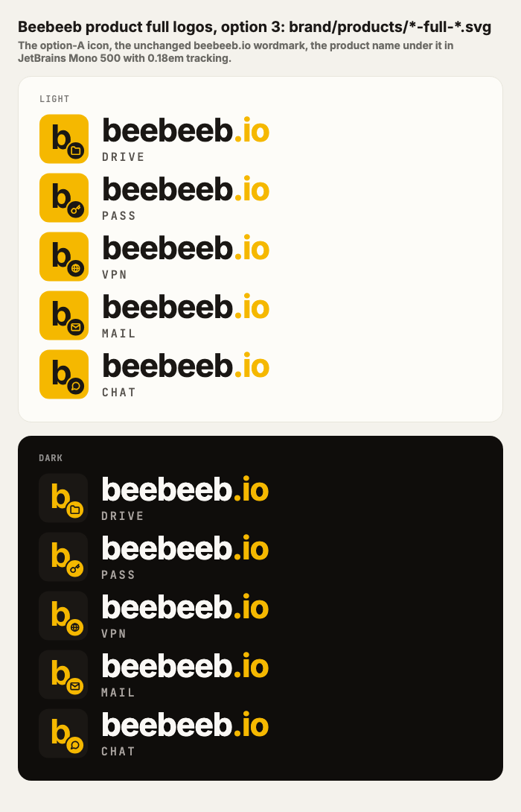

# Beebeeb product icons

**The main Beebeeb icon stays exactly as it is: the plain "b" tile, `../logo-mark.svg`.** It is the master brand mark and the app icon that ships today (Guus, 2026-11-02). It is not one of these files and nothing here replaces it.

Each PRODUCT (Drive, Pass, VPN, Mail, Chat) shows the same "b" with its own little badge. That is ONE icon pattern (option A, task 2322): the Beebeeb "b" on the tile, plus the product's glyph on a round badge, bottom right. A product is told apart by its glyph and its name, never by colour.



| Tone | Tile | b | Badge | Glyph |
|------|------|---|-------|-------|
| `-light` | Amber `#F5B800` | ink `#1A1714` | ink | Amber |
| `-dark` | ink `#1A1714` | Amber | Amber | ink |

The tile is 512 x 512 with `rx` 102, the same as `../logo-mark.svg`, and the "b" is that file's Inter Bold glyph path (read from it by the generator, never live text).

## Full logos

`{product}-full-{light,dark}.svg` (800 x 100, the canvas of `../logo-full.svg`): the product icon, then the unchanged `beebeeb.io` wordmark (Inter 700, `.io` in Amber, letter-spacing as `logo-full.svg`), then the product name underneath it as a label: JetBrains Mono 500, UPPERCASE, letter-spacing 0.18em, `#57534e` (light) or `#a8a29e` (dark). Wordmark and label are left-aligned and the label sits close under the wordmark. Like `logo-full.svg`, the wordmark and label are live text in a font stack, not paths. The main logo (`../logo-full.svg`) is untouched.



## Glyphs

| Product | Glyph | Icon | Full logo |
|---------|-------|------|-----------|
| Drive | folder | `drive-{light,dark}.svg` | `drive-full-{light,dark}.svg` |
| Pass | key | `pass-{light,dark}.svg` | `pass-full-{light,dark}.svg` |
| VPN | globe | `vpn-{light,dark}.svg` | `vpn-full-{light,dark}.svg` |
| Mail | envelope | `mail-{light,dark}.svg` | `mail-full-{light,dark}.svg` |
| Chat | speech bubble | `chat-{light,dark}.svg` | `chat-full-{light,dark}.svg` |

**The shield is reserved for encryption state.** VPN uses a globe so the shield keeps meaning "encrypted" everywhere it appears. Never use it as a product glyph.

## Regenerating

The SVGs are generated; edit `build.py`, not the files.

```sh
python3 brand/products/build.py           # write the 20 SVGs
python3 brand/products/build.py --check   # exit 1 if a file differs from the generator
```

`preview.png` and `preview-full.png` are renders of these SVGs at the time they were last generated.

## Status

These are assets only. No shipped app icon (iOS, macOS, desktop, Android, favicon, site) uses them: the main "b" from `../logo-mark.svg` keeps shipping, Drive included, until Guus decides otherwise. The web components that draw the same icons are `BBProductIcon` and `BBProductLockup` in `@beebeeb/shared`.
