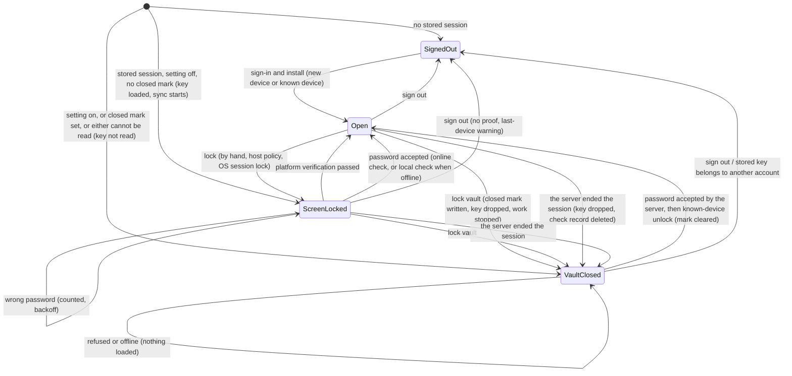

# Two-level lock: screen lock and vault lock (contract)

Status: contract, no code yet. Date: 2026-11-13. Source: product decision 2495 ("two levels"), with the
ruling that the rules and the cryptography live in this repository and every client only binds them.
Reviewed once (section 11); the questions it left open are decided (section 10).

A native Beebeeb app is a sync client: background sync needs the account key. So "locked" cannot mean
"the key is gone" by default. This contract defines two levels, says exactly what each one protects, and
never calls either one encryption of the device.

| | Screen lock (level 1) | Vault lock (level 2) |
|---|---|---|
| What the person sees | "Beebeeb is locked on this PC. Sync continues." | "Beebeeb is locked. Sync is paused until you unlock." |
| Account key in this app's process | stays loaded | dropped; every copy the client handed out is refused and wiped on drop |
| Account key in the OS credential store | stays | stays (decision D1) |
| Sync | runs | stopped, said honestly |
| Opened with | platform user verification (Windows Hello) first, or the account password | the account password proven to the server (plus the authenticator code when the account has one), then core's known-device unlock |
| Network needed to open | no (password: checked locally when the server cannot be reached) | yes |
| Survives a restart | the app always starts at least screen-locked | yes: a closed vault stays closed until the strong unlock |
| Default | the app opens in this state at every start | off; on with "Ask for my password when Beebeeb starts" |

## 1. Defaults

- At operating-system start: no password. The stored key is loaded, sync starts, the app window opens
  screen-locked.
- "Ask for my password when Beebeeb starts" is off by default. When on, the app starts vault-closed: the
  stored key is not read at all at start, and sync does not start until the strong unlock.
- A person can lock either level by hand at any time ("Lock", "Lock and pause sync"). A vault closed by
  hand stays closed across a quit or a reboot, whatever the start setting says (section 4).

## 2. States and transitions



Rules of the machine:

- `ScreenLocked` and `Open` differ only in what the host may show and do; the key and the work are the
  same. `VaultClosed` has no usable key in this app's process.
- There is no arrow from `VaultClosed` to `ScreenLocked`, and none into `Open` except the strong unlock.
  Platform verification and the local check never open `VaultClosed`: a weaker proof never opens the
  stronger level, also not by restarting the app.
- Platform verification is a statement by the host that the operating system verified the user. Core
  cannot check it, so it is trusted only for the level that is a screen gate.
- A session the server no longer accepts moves `Open` and `ScreenLocked` to `VaultClosed`: the key is
  dropped, and only a fresh password sign-in with the known-device unlock opens it again.
- The names avoid `Locked`: `SessionKeyState::Locked` already means "this session has not proved the key"
  and is a different thing.

## 3. Screen lock: the local password check

### 3.1 What it is, honestly

A check value in the OS credential store that answers one question offline: "is this the account
password that was last proven on this device?". It unwraps nothing. The account key sits next to it in
the same store, not under the password.

- It protects: the app window against a person at the keyboard who does not know the password and cannot
  pass platform verification.
- It does NOT protect: the key, the session, or files. Whoever can read the credential store (a program
  running as the user, or someone with the disk and the user's operating-system login) reads the key
  directly and does not need the password.
- **It adds an exposure that a native device does not have today.** A reader of the store gets the key
  and the session token today, but nothing to test password guesses against. With this record they can
  guess the account password offline, at the cost of 3.3 per guess. A guessed password together with the
  stored session opens the actions the password guards (change password, change email, delete the
  account), and it is the password of the person's other sign-ins. This is accepted for 0.9.0 (decision D2); until the
  hardware-bound pepper ships the only defence is the memory-hard cost, and the record is never written
  to a plain file.
- With sync running, files in the sync folder stay reachable through the file manager while the app is
  screen-locked. Copy never suggests otherwise.
- **Copy rule:** screen-lock words never say or imply that the password decrypts, opens or protects the
  files or the key. Allowed: "Beebeeb is locked on this PC. Sync continues.", "Unlock to see your files."
  Not allowed: "vault" on the screen-lock level, "encrypted while locked", "your files are protected by
  your password".

### 3.2 The record

Pure functions in `beebeeb-core` (new module `screen_lock`), no I/O, no clock:

```
stretch   = Argon2id v19 (password bytes, salt, m = 256 MiB, t = 4, p = 2, 32 bytes out,
                          associated data = "beebeeb/screen-lock/v1/stretch")
check_key = HKDF-SHA256 (ikm = stretch, no salt, info = "beebeeb/screen-lock/v1/key", 32 bytes)
token     = 32 random bytes from the OS CSPRNG, used for nothing else, wiped after sealing
sealed    = AES-256-GCM (check_key, random 96-bit nonce, token,
                         aad = "beebeeb/screen-lock/v1" || u32 BE len || owner id (UTF-8) || header)
header    = version (1 byte, = 1) || pepper kind (1 byte, = 0) || password counter (u64 BE) || salt (32)
record    = header (42) || nonce (12) || ciphertext (32) || tag (16)          = 102 bytes
```

- **The password bytes are exactly the bytes the sign-in hands to OPAQUE** (no extra normalization), so
  the local check and the server can never disagree about the same typed password.
- **Domain separation:** the Argon2id call carries its own label as associated data, so its output is
  never the output of the master-key derivation for the same password and salt.
- **Salt:** 32 random bytes, new for every record (every enrolment and re-enrolment).
- **Verification** is "the tag verifies"; the token's value is never compared, returned or used as a key.
- **AAD binds** the record to the account (owner id) and to its own header, so a record cannot be moved
  to another account or have a header field edited.
- **Password counter:** the server's count of password changes for the account as of the enrolment
  (0 when the server reports none). It is how a device learns that the record is stale (3.7).
- **Pepper kind:** reserved. Version 1 writes 0 and refuses anything else. A later version may mix in a
  secret held by the device's hardware, so that a copied record cannot be guessed off the device.
- Three new labels (`…/stretch`, `…/key`, the AAD domain), listed in `label_table_tests.rs` with a
  cross-slot prefix entry as the passkey seal has. A change is a new `v2`, never an edit. Generated
  vectors (`test-vectors/screen_lock.json`) with a drift guard.
- `stretch`, `check_key`, the token and the Argon2 block buffer are `Zeroizing` (the existing
  `allocate_argon_memory`); the password is a `Zeroizing<String>` end to end; nothing prints.
- The record never contains, derives from, or wraps the account key, a file key or a session token.

### 3.3 KDF choice

**Argon2id v19 with core's canonical parameters, exactly: 256 MiB, 4 iterations, parallelism 2, 32-byte
output**, the same cost as the master-key derivation and the OPAQUE key stretch.

- Why not weaker: the record is a guessing target for the account password, held on a device.
- Why not stronger: 256 MiB is already the amount a small PC can fail to allocate, and the unlock has to
  stay near a second. More cost here does not remove the exposure of 3.1; a hardware-bound pepper would.
- The cost is not stored: version 1 means these numbers. A reader accepts no others, so there is no cost
  field to edit and no range to police. A change of cost is a new version.
- If Argon2id cannot allocate, the answer is "local check unavailable": the host falls back to platform
  verification or the online check. Never to lower parameters.

### 3.4 Where it lives

Through core's `SecretStore`, next to the session entries, never a plain file:

| Name | Content |
|---|---|
| `lock.screen_check` | the record of 3.2 (102 bytes) |
| `lock.attempts` | failed-try count and the time of the last failure (3.5) |
| `lock.ask_password_at_start` | the level-2 start setting |
| `lock.vault_closed` | the closed mark of section 4 |

- `SecretStore` is a trait: on Apple platforms core's Keychain store; on Windows the host supplies the
  implementation over the Windows credential store (core has none today, and gets none from this
  contract). The host's store must be this-device-only and non-roaming, as the Keychain entries are.
- All four are removed with the device session, at both places core removes one: the device-session
  purge and the account-change branch of the session save. A record whose AAD does not match the stored
  owner is deleted and treated as absent.
- `lock.screen_check` and `lock.attempts` are also deleted when the server ends the session and when the
  server's password counter differs from the record's.
- App-only sign-out (one app of several on a device) keeps them: they belong to the account on the device.

### 3.5 Wrong tries

A pure rule in `screen_lock` (`AttemptState` in, a decision out; the caller passes the time, core holds no
clock), with the state persisted in the store so restarting the app does not reset it.

| Consecutive failures | Wait before the next password try |
|---|---|
| 1 to 4 | none |
| 5 | 30 seconds |
| 6 | 1 minute |
| 7 | 5 minutes |
| 8 | 15 minutes |
| 9 | 1 hour |
| 10 | the local check turns off: the record is deleted; only platform verification or the online check opens the screen |

- The wait gates **every** password try from the screen lock, the online check included. One typed
  password counts once, whichever checks it went through.
- The count is written **before** any check runs and reset only by a success, so ending the process
  mid-check does not buy a free try. If the count cannot be written, the try is refused.
- A clock that reads earlier than the stored last failure restarts the full wait from now.
- Any successful unlock (platform verification, local, online, strong) resets the count.
- A lockout never deletes the account key, the session or any file. It only removes the offline password
  path until the password is proven online again.
- **What counts as a wrong try online.** A wrong password fails on the device, in the OPAQUE finish,
  before anything is sent: the server never sees it and cannot count it. So the local count is the only
  limit on wrong passwords here, online as well as offline, and it is not optional. A 401 on either leg
  of the online proof is never a wrong try: core asks whether the session is still alive; an ended session is
  the `VaultClosed` arrow, a live one is the server's limit, shown as "too many tries, wait". Core must
  tell these apart (today a 401 on the second leg reads as "password not confirmed": a core change).
- **Starts are the server's to limit.** Every online try opens a proof at the server, and those starts
  may count toward the account's sign-in guess limit. The local wait keeps a person at the keyboard from
  spending that limit quickly. A per-session limit on those starts is part of server prerequisite S2, with its own test.
- An account still on the legacy key stretch is refused by the online check; the outcome is its own
  kind ("sign in again to finish an account upgrade"), never "wrong password".
- This limits a person at the keyboard. It does nothing against someone who copied the record; 3.3 is
  the only defence there, and the threat table says so.

### 3.6 When the record is written

Only at a moment the server has just accepted that exact password:

1. Sign-in on the device (new device or known device): the record is computed when the server accepts the
   OPAQUE finish, while the password is still in hand, and travels inside the opaque sign-in values
   (through the authenticator challenge when there is one, then `PasswordAccepted`). It is saved in the
   same step that saves the installed session, never before.
2. A password change made on this device (the new password, after the server accepted the change).
3. A successful online check from the screen lock (below).

An install that has no record (upgraded from an older version, or signed in without typing a password)
has no offline password path until case 3 happens once. Platform verification still works.

### 3.7 Order of the checks, and a password changed on another device

**When the server can be reached, the password is proven online** on the current session (the OPAQUE
proof that grants nothing, server prerequisite S2); the local record is then written or refreshed. **The local check alone decides only when the
server cannot be reached.** So a stale record is never what opens the screen of a connected device.

After a password change elsewhere, one of two things is true, depending on the server's session policy:

- The server ended this device's session: the device goes to `VaultClosed` at its next contact, the
  record is deleted, and the new password with the strong unlock opens it.
- The session survived (it had proved the key): the record is stale. Online, the new password is accepted
  by the server and replaces the record; the old one is refused. The device also deletes the record as
  soon as the server's password counter differs from the record's, also for a person who only ever
  unlocks with platform verification.

What remains, said plainly: **on a device that has been offline since the change, the old password
still opens the screen lock** (and only the screen: the key was never under it). Offline, the new
password is a wrong try, and the words say "If you changed your password on another device, connect to
the internet to unlock."

The password counter is server prerequisite S1 (section 10).

## 4. Vault lock

- **Lock:** in this order: the closed mark `lock.vault_closed` is written; the in-memory key is dropped;
  the account generation advances, so every key copy and derived key the client handed out is refused as
  stale and wiped when its holder drops it; `WorkStopped` is emitted. If the mark cannot be written the
  lock still happens in memory and the caller is told it will not survive a restart. Sync, uploads,
  downloads, thumbnails and search stop; on-demand files that are not on the device cannot be fetched.
  The host shows this as paused-by-lock, never as "up to date".
- **No key before the proof.** A start never loads the stored key for a closed vault, and no restore
  path may load it without core's strong unlock: the desktop engine's unconditional start-up restore is
  replaced, not wrapped (section 7).
- **Start:** the vault starts closed when the setting is on, when the closed mark is set, or when either
  cannot be read. The key entry is then not read. Test hook: zero reads of the key entry between start
  and the strong unlock.
- **Unlock:** `Client::sign_in_on_device` (password; `Client::submit_two_factor` when the account has an
  authenticator) gives a `PasswordAccepted`; `Client::unlock_known_device(accepted, store)` checks the
  stored owner, loads the stored key, proves the key to the server for the new session, refreshes the
  stored token and installs the session. The closed mark is cleared in that same step and by nothing
  else. No client carries its own copy of these steps.
- **Needs the network, and the authenticator code when the account has one.** Offline, a closed vault
  stays closed, and the app says "You're offline. Beebeeb can't unlock until it can reach the server."
- **The replaced session:** the strong unlock creates a new server session. The session it replaces is
  ended at the server: best effort when the vault is locked, and again after the new one is installed, so
  a closed-and-opened vault leaves no live session behind. This is a core change (today the old token is
  only overwritten).
- **Turning the start setting off** needs the password proven to the server (never the local check, never
  platform verification); offline it cannot be turned off. Turning it on asks for nothing.
- **What it is not:**
  - Not at-rest protection. The key stays in the OS credential store; see the threat table and decision D1.
  - Not a guarantee about other processes: another Beebeeb app or helper that shares the store can still
    load the key. "No key" is a statement about this app's process.
  - Not a wipe of local data: files already on the disk and the local store's plaintext cache of names,
    types and sizes stay where they are.
  Copy says "locked" and "sync is paused", never "encrypted while locked".

## 5. Where each piece lives in core, and the API a client calls

| Piece | Crate and module | Kind |
|---|---|---|
| State machine, levels, start rule, what each state allows | `beebeeb-api`, `flows/lock.rs` (next to `flows/sign_in.rs`, `flows/recovery.rs`) | I/O-free, no clock, no key material: progress flags only |
| Record format, seal, verify, attempt rule | `beebeeb-core`, `screen_lock` | pure cryptography and rules |
| Storage names, purge, enrolment, drop-key / load-key, the online check, the strong unlock | `beebeeb-client`, `lock.rs` and the existing `auth/` | service over `SecretStore` and the transport |

`beebeeb-api::flows` (new):

```rust
pub enum LockState { SignedOut, Open, ScreenLocked, VaultClosed }
pub enum LockLevel { Screen, Vault }
/// `None` = the entry could not be read: the vault starts closed.
pub struct StartFacts { pub session_stored: bool, pub ask_password_at_start: Option<bool>, pub vault_closed: Option<bool> }

impl LockFlow {
    pub fn at_start(facts: StartFacts) -> Self;
    pub fn state(&self) -> LockState;
    pub fn lock(&mut self, level: LockLevel) -> Result<(), FlowError>;
    pub fn platform_verified(&mut self) -> Result<(), FlowError>;      // ScreenLocked only
    pub fn password_checked(&mut self) -> Result<(), FlowError>;       // ScreenLocked only
    pub fn session_ended(&mut self);                                   // Open, ScreenLocked -> VaultClosed
    pub fn known_device_unlocked(&mut self) -> Result<(), FlowError>;  // VaultClosed or SignedOut
    pub fn signed_out(&mut self);
}
pub const fn key_may_be_loaded(state: LockState) -> bool;   // Open, ScreenLocked
pub const fn work_may_run(state: LockState) -> bool;        // Open, ScreenLocked
pub const fn screen_locked_allows(action: LockedAction) -> bool;
```

`beebeeb-core::screen_lock` (new):

```rust
pub struct ScreenCheckRecord;                 // opaque, to_bytes / from_bytes, Debug prints the length only
pub fn enroll(password: &Zeroizing<String>, owner: &str, password_counter: u64)
    -> Result<ScreenCheckRecord, CoreError>;
pub fn verify(record: &ScreenCheckRecord, password: &Zeroizing<String>, owner: &str)
    -> Result<CheckOutcome, CoreError>;       // Match | NoMatch | Unusable (version, pepper kind, owner, length)
pub struct AttemptState { /* failures, last_failure_ms */ }
pub fn next_try(state: &AttemptState, now_ms: u64) -> TryDecision;   // Allowed | WaitUntil(ms) | LocalCheckOff
```

`beebeeb-client::Client` (new, beside the existing `sign_in_on_device`, `submit_two_factor`,
`unlock_known_device`, `sign_out_this_app`):

```rust
pub fn start_from_store(&self, store: &dyn SecretStore) -> Result<LockState, AuthError>;
pub fn lock_state(&self) -> LockState;
pub fn lock_screen(&self) -> Result<(), AuthError>;
pub fn unlock_screen_platform_verified(&self, store: &dyn SecretStore) -> Result<(), AuthError>;
pub async fn unlock_screen_with_password(&self, password: Zeroizing<String>, store: &dyn SecretStore,
    now_ms: u64) -> Result<ScreenUnlock, AuthError>;
    // Opened | Wrong { wait_ms } | ServerLimit { wait_ms } | LocalCheckOff | OfflineNoRecord | AccountUpgradeNeeded
pub async fn lock_vault(&self, store: &dyn SecretStore) -> Result<VaultLocked, AuthError>;
    // the new generation, and whether the closed mark was stored
pub async fn set_ask_password_at_start(&self, on: bool, password: Option<Zeroizing<String>>,
    store: &dyn SecretStore, now_ms: u64) -> Result<(), AuthError>;
```

Rules a client follows:

- One state machine per app process; a client never tracks "locked" beside it.
- A client never reads the key entry itself and never compares passwords itself.
- `unlock_screen_platform_verified` is called only after the operating system's own user-verification
  prompt returned success for the current user; a cancelled or unavailable prompt calls nothing.
- While `ScreenLocked` a host shows no file names, no account data and no thumbnails, keeps the window out
  of screen capture, and refuses every action except unlock, lock vault and sign out
  (`screen_locked_allows`).

Changes in core that this contract asks for: a call that drops the key but keeps the stored session
(`lock_vault`); ending the replaced session; telling the server's guess limit apart from a judged
password in the online proof; carrying the record through the authenticator challenge; and the online check
itself, which uses the grant-nothing proof of server prerequisite S2, not the step-up.

## 6. Bindings and reuse

- **Desktop (native, Rust):** calls `beebeeb-client` directly and supplies the `SecretStore` and the
  platform verification prompt.
- **iOS / Android (UniFFI):** `unlock_known_device` is already exported (`services/auth.rs`); the lock
  calls of section 5 would join the same service surface. No work in this contract.
- **Web (WASM):** `beebeeb-wasm` builds on `beebeeb-core` and `beebeeb-api`, not on `beebeeb-client`, so
  web can reuse the pure pieces (`flows::lock`, `screen_lock`). Web's own unlock, which opens the key
  again from the password, stays as it is. No work in this contract.

## 7. Desktop binding (0.9.0, Windows first)

| State | Frame |
|---|---|
| `SignedOut` | DW-A01 / DW-A02 (first run and sign in) |
| `ScreenLocked` | DW-0009 ("Beebeeb is locked", status line "Locked · sync keeps running"); its Unlock starts Windows Hello |
| `ScreenLocked`, password fallback | no frame yet: DW-0009 has no password field. Needs a drawn frame (or DW-A30's screen with screen-lock words) before it is built |
| `VaultClosed` | DW-A30 ("Unlock your vault", password), then the sign-in window's code step when the account has an authenticator |
| `VaultClosed`, sync paused in tray and status | no frame yet |
| Wrong tries, wait | DW-A22's hint pattern; the wait text has no frame yet |

Replaced in the desktop engine once the native sign-in/unlock binding has merged:

- The engine's own password unlock (a `StepUp::Generic` proof followed by the engine's stored-key loader):
  for the screen lock by `unlock_screen_with_password`, for the vault by `sign_in_on_device` +
  `unlock_known_device`. The host adapter's `begin_unlock` stays and calls the level the state names.
- The start-up restore that loads the key unconditionally: by `start_from_store`.
- The engine's lock call: by `lock_screen` / `lock_vault`.
- `begin_hello` / `cancel_hello` (today an immediate refusal): bound to the Windows user-verification
  prompt for the app's window, then `unlock_screen_platform_verified`.
- The engine's own credential-store module becomes the Windows `SecretStore` implementation.

## 8. Threat table

"Stops" means the attacker does not get it through Beebeeb.

| Attacker | Screen lock | Vault lock |
|---|---|---|
| Shoulder-surfer (sees the screen) | Stops: file names, account data and thumbnails are not drawn; the window is excluded from capture. Does not stop: watching the password being typed (the field is masked; Hello shows nothing to copy). | Same. |
| Someone at the unlocked OS session who runs nothing | Stops: opening the app, account and sharing actions, guessing the password quickly (backoff, then local check off). Does not stop: opening the sync folder in the file manager; files on demand still download, because sync runs. Tries may count toward the account's guess limit at the server (3.5). | Stops the same, plus fetching files that are not on the device. Does not stop: files already on the disk. |
| The same person, running a program | Is "malware running as the user" below. | Same. |
| Disk thief without the OS login | Nothing added by either level. The credential store and the files are as safe as the operating system makes them (login-bound store protection, disk encryption if on). Synced files and the local name cache on an unencrypted disk are readable. | Same. |
| Disk thief with the OS login | Stops nothing: reads the stored key and session token directly, and the files. **Gains from this feature:** the check record, an offline guessing target for the account password at Argon2id 256 MiB per guess, which did not exist on the device before. | Stops nothing: the key is still in the store. The record is there too. |
| Malware running as the user | Stops nothing: reads the store, the process memory and the keyboard. Gains the same guessing target. | Removes the key from this app's process only; the store still holds it. Stops nothing that matters. |

Summary sentence for product copy and docs: both levels are locks on the app, not encryption of this PC.
Disk encryption and the operating-system login protect a device at rest; Beebeeb's encryption protects
the data on the server and in transit.

## 9. Verification for the build (declared now)

- `screen_lock`: vectors; a record with a foreign owner, a flipped header bit, a non-zero pepper kind, a
  wrong version or a wrong length is `Unusable`, each proven red by a mutant; the stretch differs from
  `derive_master_key` for the same password and salt; no secret in `Debug`.
- Attempt rule: table-driven over the schedule, a clock set back, the count persisted before the check
  (a process ended mid-check still counts), a failed write refuses the try, one typed password counts
  once, a 401 on either leg of the online proof is not a wrong try, a server limit is not a wrong try; server side:
  a per-session limit on proof starts.
- `flows/lock.rs`: every arrow of section 2 and every missing arrow (platform verification and the local
  check on `VaultClosed` are refused; unreadable start facts start closed).
- Client: start with the setting on or the mark set reads the key entry 0 times; lock vault, quit, start:
  still closed; after `lock_vault` every outstanding key copy is refused and work has stopped; online
  beats a stale record; a counter mismatch and an ended session delete the record; both purge places
  remove all four entries; the strong unlock still works after the server forgot the device's hardware
  identity in a password change.
- Desktop: the frames of section 7 on a real Windows build, with a Hello prompt and with Hello absent.

## 10. Decisions (2026-11-13)

The five questions the design review left open were decided by the product owner on 2026-11-13. None is
open any more.

- **D1. The vault lock is not at-rest protection.** The key stays in the OS credential store; the vault
  lock is a process-and-work lock, opened by the server-proven password and `unlock_known_device`. Copy
  is honest about it and makes no at-rest claim. (Decision 2495's option text spoke of re-deriving the
  key; its resolution named the known-device unlock. The resolution stands. Not chosen: a password-sealed
  key in the store, which would make the key itself an offline guessing target, and removing the key,
  which is a sign-out of the device.)
- **D2. The offline password record is accepted for 0.9.0**, with the exposure of 3.1 stated as it is.
  **Named follow-up, "hardware-bound pepper", in a 0.9.x update:** a secret held by the device's TPM is
  mixed into the stretch, so a copied record cannot be guessed off the device. It uses the reserved
  pepper-kind byte of the header: a new value written by new versions, with version-1 records (kind 0)
  re-enrolled at the next server-proven password. Until it ships, section 8's "gains from this feature"
  rows stay true and stay in the copy guidance.
- **D3. Sign-out from the screen lock needs no proof.** A person who cannot unlock can leave. It removes
  the stored key, so the existing last-device key-loss warning (`sign_out_advice`) is shown first.

**Server prerequisites.** The server builds both; the code named here does not ship before its
prerequisite is live:

- **S1. A password counter reported with the session** (a count of password changes for the account).
  Prerequisite for writing the check record with a real counter and for the stale-record deletion of
  3.7. Before it is live, no record is enrolled with a counter other than 0, and a release that enables
  the offline password path waits for it.
- **S2. A password proof for the current session that grants nothing** ("verify the password", no
  confirmation minted). Prerequisite for the online check of the screen lock (`unlock_screen_with_password`
  and turning the start setting off). The step-up that mints a confirmation for destructive account
  actions is not used for unlocking. Its refusals must tell a judged password, the server's limit and an
  ended session apart, and it carries a per-session limit on starts (3.5).

## 11. Design review

One internal automated crypto and security design review, design only, against core main `56cd54f`.
Its verdict, verbatim:

> APPROVE WITH CHANGES — design-only review of the two-level lock contract against core main 56cd54f (no
> implementation reviewed): the record construction is sound, but two P1s must be fixed in the contract
> before code.

Both P1 findings are folded in: a closed vault now survives a restart (the closed mark, section 4), and a
stale record no longer opens a connected device (online first, the password counter, deletion when the
session ends, section 3.7). Also folded in: the start setting is turned off only with a server-proven
password; an ended session is a state change to `VaultClosed`; the record is named as a new exposure
(3.1, the threat table, decision D2) with a reserved pepper field; the cost is fixed by the version and the
Argon2id call is domain-separated; the wait gates the online check, a typed password counts once, the
server's limit is not a wrong try, a failed count write refuses the try; the grant-nothing proof is a prerequisite, not a wish; "no
key" is scoped to the process and its handed-out copies; sign-out from the screen lock is decision D3; the label
table entry, the enrolment moment, both purge places, the device-only host store and ending the replaced
session at lock time.

The review confirmed: the Argon2id numbers equal core's canonical ones and the OPAQUE stretch, the
password bytes reach OPAQUE without normalization, the label style matches the passkey seal, and no
"Never break" rule is violated. It did not verify: deployed server settings, and host behaviour (the
Hello prompt, capture exclusion, the Windows store).
